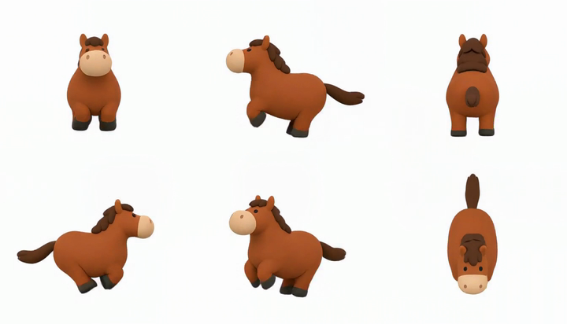

# Horse gallop motion reference

| Measure | Value |
|---|---|
| Model | MiniMax H3 |
| Driver | MiniMax H3 local first-frame video |
| Effort | unknown |
| Scope | Two-second excerpt from the six-view AI-generated gallop reference used for the Opus and Fable horse trials |
| Completed | true |
| Evaluations | unknown |
| Runtime seconds | unknown |
| Driver turns | unknown |
| Prompt tokens | unknown |
| Cached prompt tokens | unknown |
| Cache write tokens | unknown |
| Completion tokens | unknown |
| Reasoning tokens | unknown |
| Model calls | unknown |
| Cost USD (unavailable) | unknown |
| Numeric score | unknown |
| Gates passed | unknown |
| Gates total | unknown |

Token counts use the report's provider conventions. Reasoning is included in completion tokens; cache counters are not extra prompt tokens. Estimated cost is not an invoiced charge.

AI-generated motion reference from the cartoon horse sheet. The source video was used to make the motion frames supplied to the Opus and Fable horse trials; it was not used to author the Astra terrain horse.

