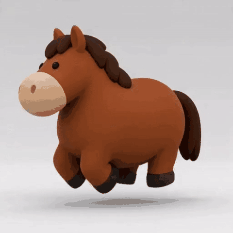

# Horse side-view gallop reference

| Measure | Value |
|---|---|
| Model | MiniMax H3 |
| Driver | MiniMax H3 via ComfyUI |
| Effort | unknown |
| Scope | Selected side-view gallop excerpt used by the Sol motion study. |
| Completed | true |
| Evaluations | unknown |
| Runtime seconds | unknown |
| Driver turns | unknown |
| Prompt tokens | unknown |
| Cached prompt tokens | unknown |
| Cache write tokens | unknown |
| Completion tokens | unknown |
| Reasoning tokens | unknown |
| Model calls | unknown |
| Cost USD (unavailable) | unknown |
| Numeric score | unknown |
| Gates passed | unknown |
| Gates total | unknown |

Token counts use the report's provider conventions. Reasoning is included in completion tokens; cache counters are not extra prompt tokens. Estimated cost is not an invoiced charge.

Side-view gallop used for the Sol motion study. AI-generated with MiniMax H3. The three-second excerpt has a visible cut when it repeats.

