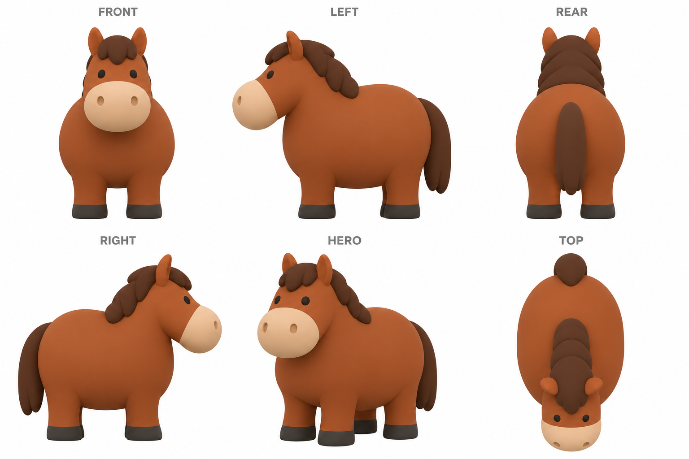
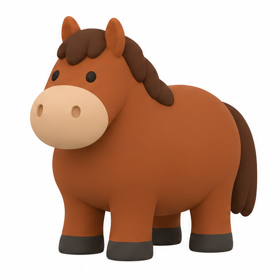

# Chunky cartoon horse reference

| Measure | Value |
|---|---|
| Model | Generated chunky cartoon horse reference |
| Driver | Generated reference sheet |
| Effort | unknown |
| Scope | Selected reference sheet and navigation thumbnail |
| Completed | unknown |
| Evaluations | unknown |
| Runtime seconds | unknown |
| Driver turns | unknown |
| Prompt tokens | unknown |
| Cached prompt tokens | unknown |
| Cache write tokens | unknown |
| Completion tokens | unknown |
| Reasoning tokens | unknown |
| Model calls | unknown |
| Cost USD (unavailable) | unknown |
| Numeric score | unknown |
| Gates passed | unknown |
| Gates total | unknown |

Token counts use the report's provider conventions. Reasoning is included in completion tokens; cache counters are not extra prompt tokens. Estimated cost is not an invoiced charge.

Generated illustrative reference; front and left views are proportion masters, but width and depth disagree across views. Hero is visual guidance, not a calibrated geometry target.

