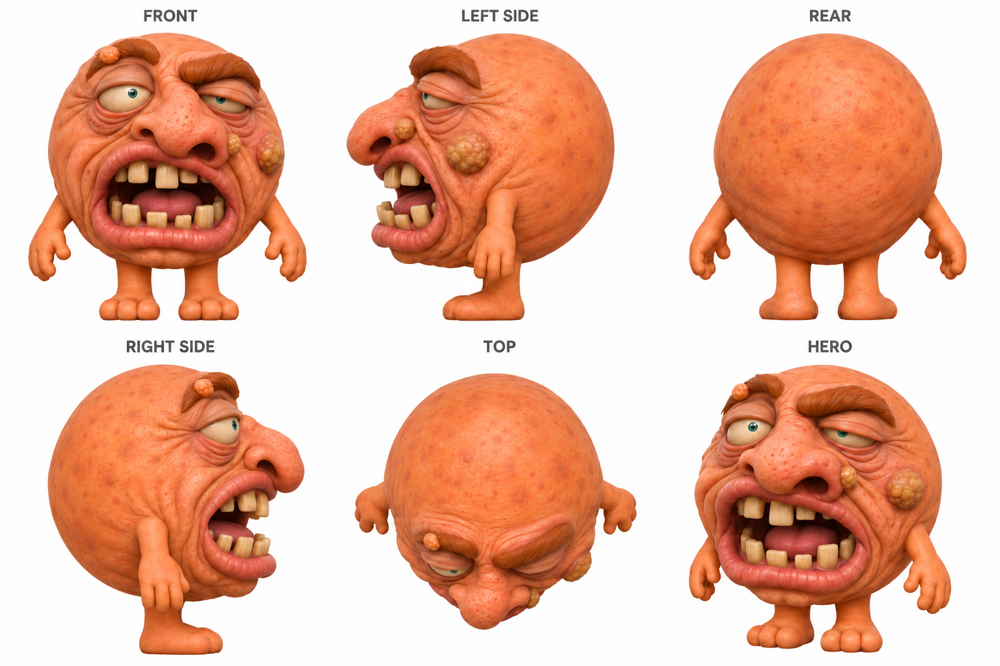

# Huge ugly head: reference

| Measure | Value |
|---|---|
| Model | User-selected reference sheet |
| Driver | User-selected reference |
| Effort | unknown |
| Scope | Accepted ugly revision reference sheet and its navigation crop. |
| Completed | unknown |
| Evaluations | unknown |
| Runtime seconds | unknown |
| Driver turns | unknown |
| Prompt tokens | unknown |
| Cached prompt tokens | unknown |
| Cache write tokens | unknown |
| Completion tokens | unknown |
| Reasoning tokens | unknown |
| Model calls | unknown |
| Cost USD (unavailable) | unknown |
| Numeric score | unknown |
| Gates passed | unknown |
| Gates total | unknown |

Token counts use the report's provider conventions. Reasoning is included in completion tokens; cache counters are not extra prompt tokens. Estimated cost is not an invoiced charge.

Illustrative hero; five orthographic views guided the model. Reference generation usage and cost were not recorded in this modeling run.

