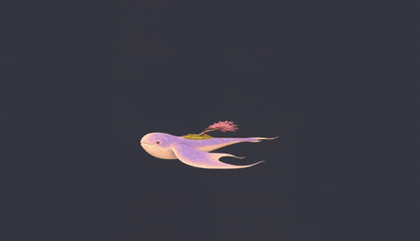
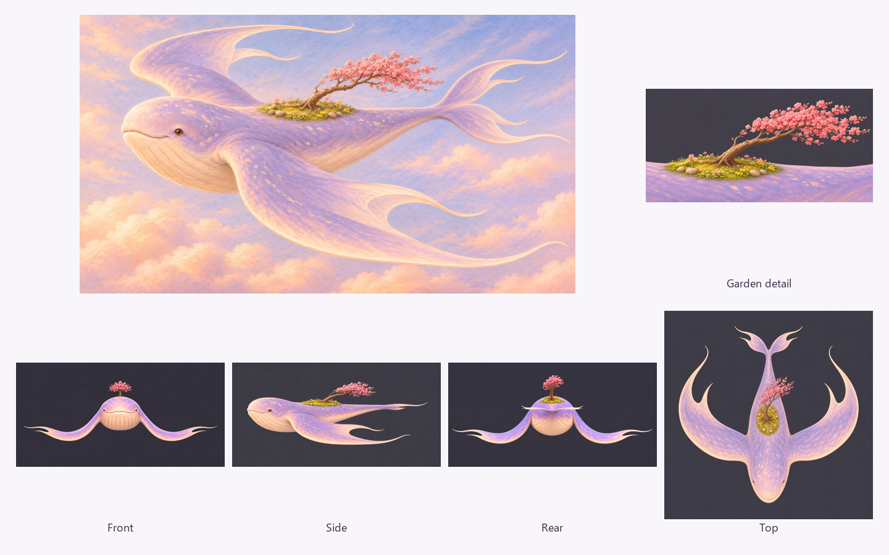

# Swallowtail Orchard reference sheet and motion

| Measure | Value |
|---|---|
| Model | MiniMax H3 reference set |
| Driver | Mesh Jig reference workflow and MiniMax H3 |
| Effort | unknown |
| Scope | Approved hero, detail and four original orthographic views. Five approved single-view motion references. |
| Completed | true |
| Evaluations | unknown |
| Runtime seconds | unknown |
| Driver turns | unknown |
| Prompt tokens | unknown |
| Cached prompt tokens | unknown |
| Cache write tokens | unknown |
| Completion tokens | unknown |
| Reasoning tokens | unknown |
| Model calls | unknown |
| Cost USD (unavailable) | unknown |
| Numeric score | unknown |
| Gates passed | unknown |
| Gates total | unknown |

Token counts use the report's provider conventions. Reasoning is included in completion tokens; cache counters are not extra prompt tokens. Estimated cost is not an invoiced charge.

